# Lumina — Visualizador e Editor de Fotos

Aplicativo para **Windows** de visualização e edição de fotos, com **upscale por IA executado 100% no seu computador** (sem enviar imagens para servidores).

Visualizador rápido e limpo + editor não destrutivo + super-resolução por rede neural (ESRGAN-Slim em TensorFlow.js).

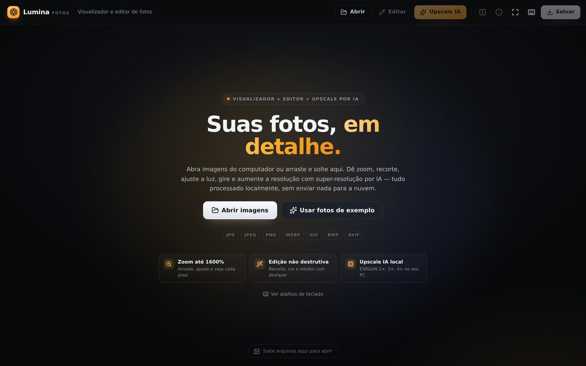

---

## Índice

- [Recursos](#recursos)
- [Como rodar](#como-rodar)
- [Como gerar o instalador do Windows](#como-gerar-o-instalador-do-windows)
- [Telas](#telas)
- [Atalhos de teclado](#atalhos-de-teclado)
- [Tecnologias e bibliotecas usadas](#tecnologias-e-bibliotecas-usadas)
- [Arquitetura do projeto](#arquitetura-do-projeto)
- [Upscale por IA: como funciona](#upscale-por-ia-como-funciona)
- [Testes](#testes)
- [Como expandir](#como-expandir)
- [Créditos e licenças](#créditos-e-licenças)

---

## Recursos

### Visualizador
- Abre **JPG, JPEG, PNG, WEBP, GIF, BMP, AVIF** (e SVG) — por diálogo nativo, arrastar-e-soltar, associação de arquivos ou menu "Abrir com".
- Imagem em tela grande, priorizando a foto; painéis discretos.
- **Zoom** com roda do mouse/trackpad (ancorado no cursor), atalhos `+`/`-`, botões e duplo clique (ajustar ↔ 100%).
- **Ajustar à tela** e **tamanho original (100%)**.
- **Arrastar** a imagem quando há zoom (pan com limites inteligentes).
- **Navegação** entre fotos com setas, botões laterais e filmes (miniaturas).
- **Girar** 90° para esquerda/direita.
- **Tela cheia** (nativa no app desktop).
- **Informações da imagem**: nome, caminho, formato, dimensões, tamanho em bytes, megapixels, proporção e o estado atual da edição.
- **Grade de terços** e **lupa de detalhe 1:1** para inspecionar pixels reais.

### Editor (não destrutivo)
- **Recorte** livre ou com proporções **1:1, 4:3, 3:4, 16:9, 9:16, 3:2, 2:3** e "Original".
- **Girar** 90° e **endireitar** (até ±45°) com grade de referência.
- **Preto e branco**.
- **Brilho, contraste e saturação** (-100 a +100).
- **Nitidez** (unsharp mask em tempo real na GPU).
- Presets rápidos de tom (Vibrante, Suave, Dramático) e histograma do original.
- **Desfazer/refazer** ilimitado na prática (80 passos), com agrupamento inteligente de gestos de slider.
- **Comparação antes/depois** com divisor arrastável.
- **Salvar como novo arquivo** em JPEG/PNG/WEBP, com qualidade ajustável — o original nunca é alterado.

### Upscale por IA
- **Super-resolução real** com o modelo **ESRGAN-Slim (RDN)**, pesos incluídos no app (~900 KB por escala), inferência local.
- Escalas **2×, 3×, 4×, 6× e 8×** (6× e 8× são compostos por passadas de rede neural: 3×+2×, 4×+2×).
- Segunda opção de motor **Lanczos 3** (reamostragem clássica, rápida, sem IA) para casos extremos.
- **Comparação antes/depois** com divisor, resolução original × nova, tempo gasto e progresso por bloco.
- **Salvar** o resultado em arquivo novo ou **adicionar à biblioteca** para continuar editando.
- Presets de **qualidade × velocidade** (bloco de 64/128/256 px), cancelamento a qualquer momento.

---

## Como rodar

### Pré-requisitos
- **Node.js 20+** (testado com Node 22)
- Windows 10/11 (o app também roda em Linux/macOS para desenvolvimento)
- GPU com WebGL (recomendado) — há fallback automático para CPU

### Instalação

```bash
npm install
```

O `postinstall` copia os pesos do modelo de IA para `public/models/` (necessário para o upscale funcionar **offline**).

### Modo navegador (desenvolvimento rápido)

```bash
npm run dev          # http://localhost:5173
```

No navegador tudo funciona, exceto os diálogos nativos do Windows: "Salvar" vira download do arquivo.

> Para testar o upscale no navegador com máxima velocidade, o Chrome usa WebGL. Sem GPU, o TensorFlow.js cai para CPU (mais lento).

### Modo aplicativo desktop (Electron)

```bash
npm run desktop      # sobe o Vite + abre a janela do app
```

Isso habilita **diálogos nativos de abrir/salvar**, "Mostrar na pasta", menu de aplicativo, tela cheia nativa e associação de arquivos (`abrir com`).

### Build web + verificação de tipos

```bash
npm run build        # typecheck + bundle de produção em dist/
npm run preview      # serve o build
```

---

## Baixar o aplicativo pronto (Windows)

Toda vez que o código é atualizado, o GitHub Actions compila e publica os binários na página de **Releases**:

**https://github.com/EtecStudy/Visualizador-de-Fotos/releases/latest**

| Arquivo | O que é | Como usar |
| --- | --- | --- |
| `Lumina-Fotos-1.0.0-Setup.exe` | Instalador (NSIS, x64) | Execute e siga o assistente. Cria atalhos no Menu Iniciar e na área de trabalho e associa `.jpg/.jpeg/.png/.webp`. |
| `Lumina-Fotos-1.0.0-portable-x64.zip` | Versão portable | Extraia o ZIP em qualquer pasta e rode `Lumina Fotos.exe` — não instala nada. |

> O build **não é assinado digitalmente**. Na primeira execução o Windows pode mostrar o aviso do SmartScreen: clique em **Mais informações → Executar assim mesmo**.
>
> O upscale por IA funciona **offline**: os pesos do modelo já vêm dentro do pacote (nada é baixado nem enviado para a internet depois de instalado).

Também é possível baixar o artefato de cada execução em **Actions → Build Windows installer → Artifacts**.

## Como gerar o instalador do Windows

```bash
npm run desktop:build
```

Gera em `release/`:
- `Lumina Fotos Setup x.y.z.exe` (instalador NSIS, x64, com atalho na área de trabalho e associação para `.jpg/.jpeg/.png/.webp`)
- versão "portable"/unpacked

Observações:
- O build de instalador precisa rodar em Windows (ou em CI Windows) para produzir o `.exe`; em Linux o `electron-builder` gera pacotes Linux equivalentes.
- Os pesos da IA já são embutidos no pacote — o app instalado funciona **offline**, sem downloads em tempo de execução.

---

## Telas

| Visualizador | Ajustes |
| --- | --- |
| 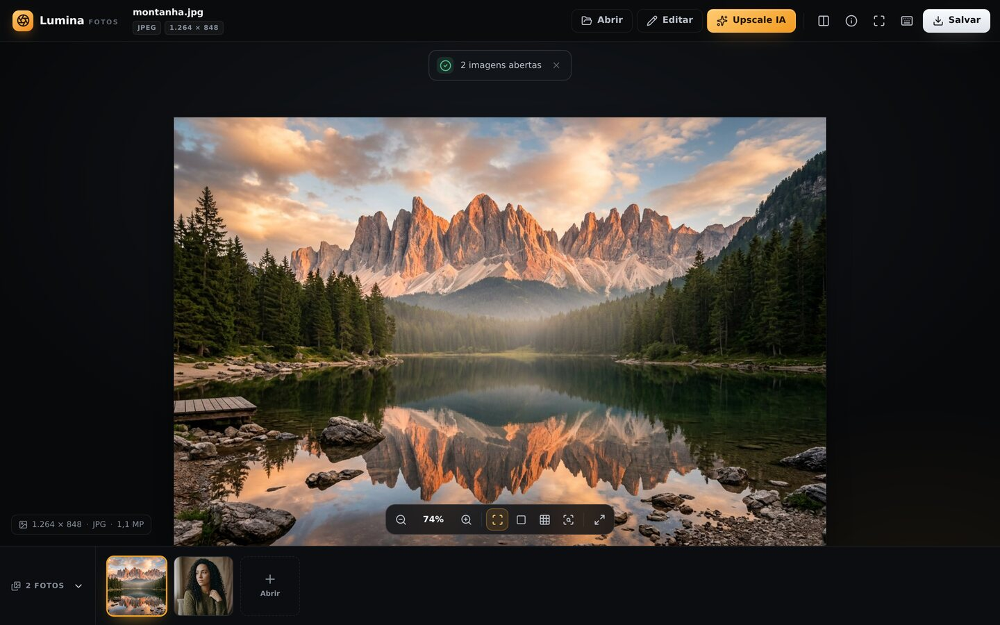 | 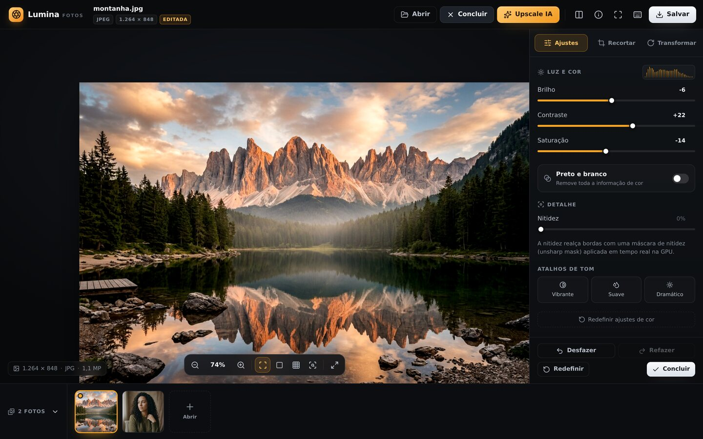 |

| Recorte | Transformar |
| --- | --- |
| 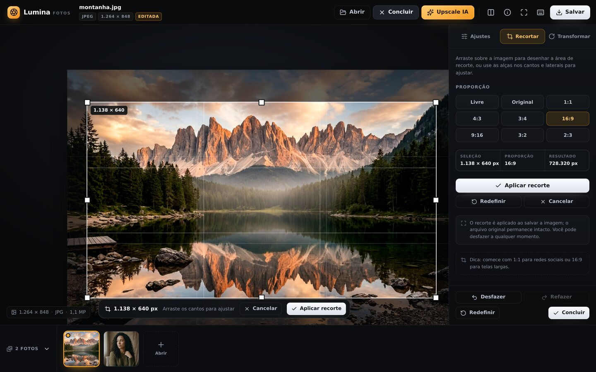 | 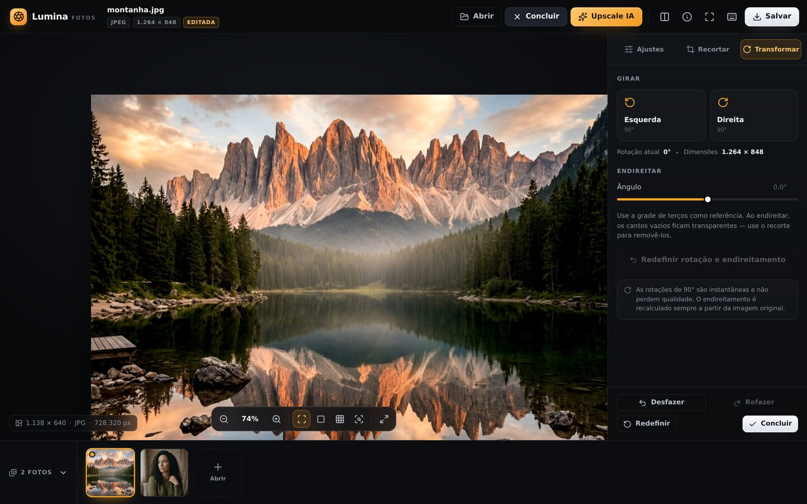 |

| Comparar antes/depois | Informações |
| --- | --- |
| 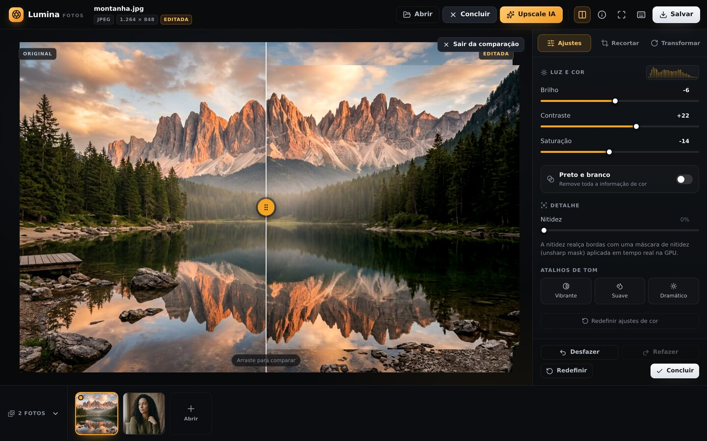 | 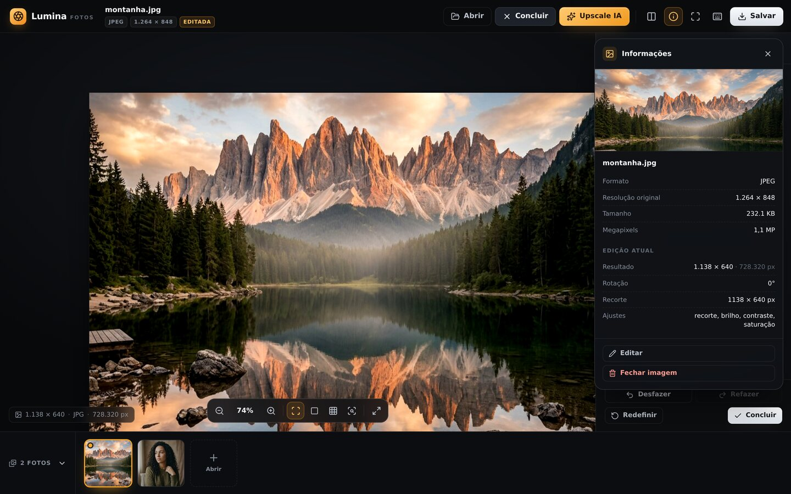 |

| Salvar | Upscale por IA |
| --- | --- |
| 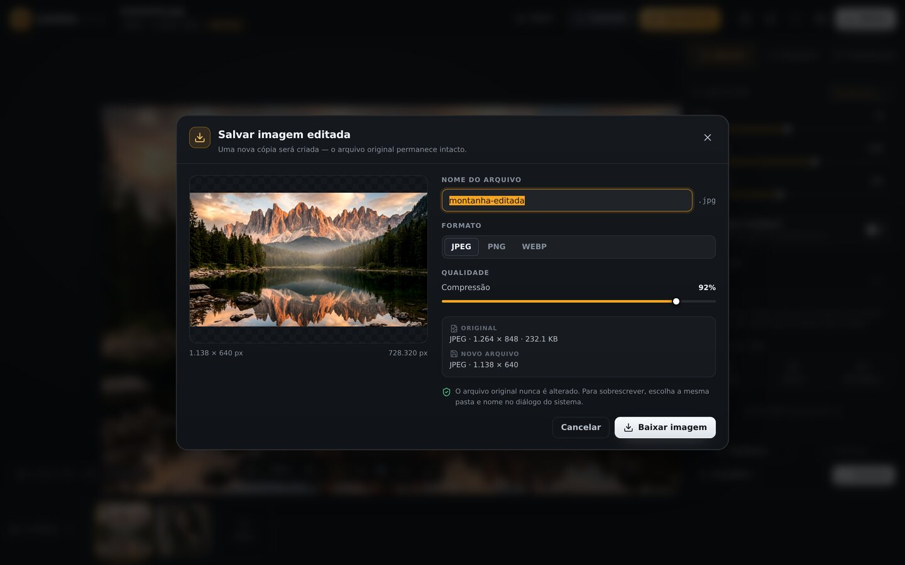 | 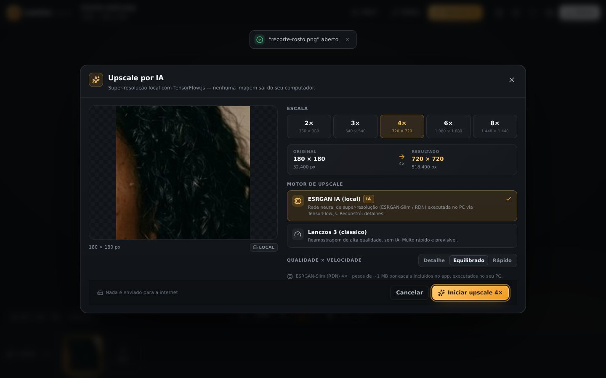 |

| Em processamento (IA local) | Resultado do upscale |
| --- | --- |
| 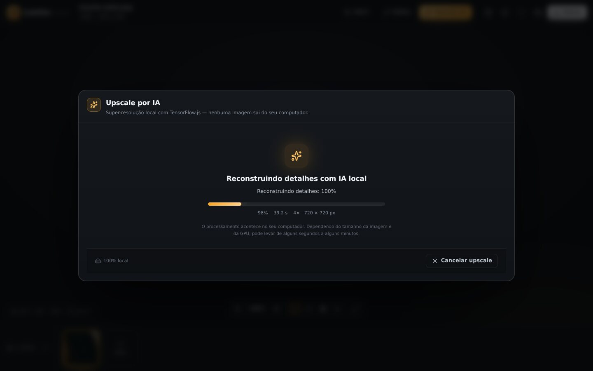 | 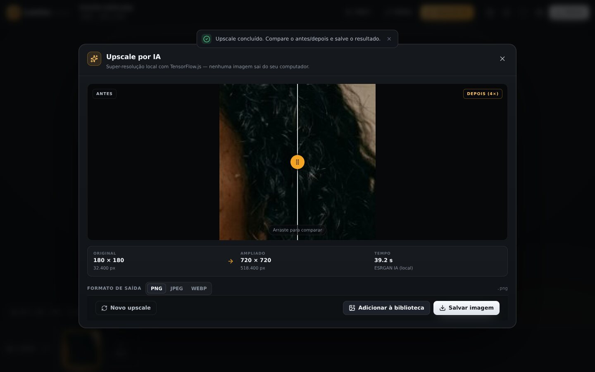 |

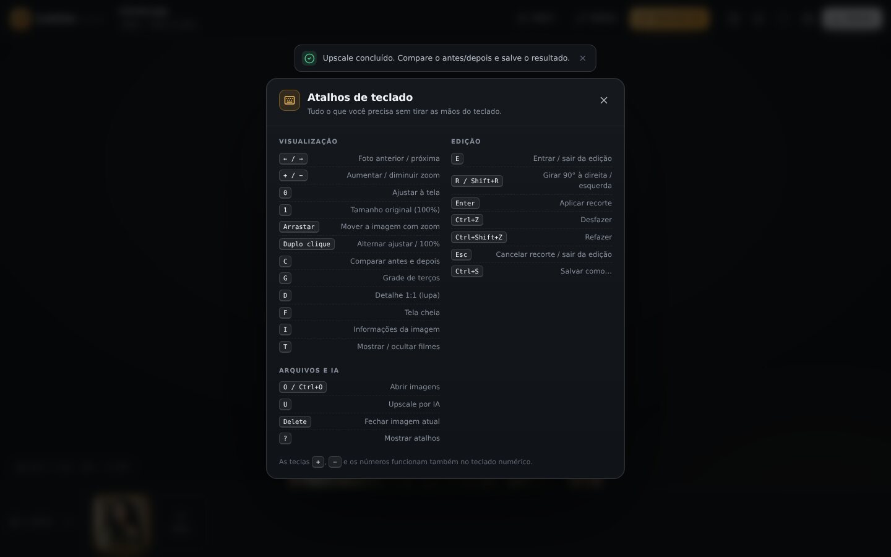

---

## Atalhos de teclado

| Teclas | Ação |
| --- | --- |
| `←` / `→` | Foto anterior / próxima |
| `+` / `-` | Aumentar / diminuir zoom |
| `0` | Ajustar à tela |
| `1` | Tamanho original (100%) |
| Duplo clique | Alternar ajustar / 100% |
| Arrastar | Mover imagem com zoom |
| `C` | Comparar antes/depois |
| `G` | Grade de terços |
| `D` | Lupa de detalhe 1:1 |
| `F` | Tela cheia |
| `I` | Informações da imagem |
| `T` | Mostrar/ocultar filmes |
| `E` | Entrar/sair do editor |
| `R` / `Shift+R` | Girar 90° direita/esquerda |
| `Enter` | Aplicar recorte |
| `Ctrl+Z` / `Ctrl+Shift+Z` | Desfazer / refazer |
| `Ctrl+S` / `S` | Salvar como… |
| `Ctrl+O` / `O` | Abrir imagens |
| `U` | Upscale por IA |
| `Esc` | Cancelar recorte / sair da edição |
| `Delete` | Fechar imagem atual |
| `?` | Mostrar atalhos |

---

## Tecnologias e bibliotecas usadas

Resumo por área (o detalhamento e as alternativas avaliadas estão em [`docs/BIBLIOTECAS.md`](docs/BIBLIOTECAS.md)):

| Área | Tecnologia | Por quê |
| --- | --- | --- |
| Shell desktop | **Electron 38** | App Windows real com diálogos nativos, menu, associação de arquivos e acesso ao disco, usando a mesma UI web. |
| UI | **React 19 + TypeScript** | Componentização, tipagem forte e estados previsíveis para uma interface complexa. |
| Build/dev | **Vite 7 + esbuild** | Dev server instantâneo, build otimizado e bundling separado do processo principal do Electron. |
| Estado | **Zustand** | Store mínimo, sem boilerplate, com seletores para evitar re-render. |
| Ícones | **lucide-react** | Ícones consistentes e leves. |
| Visualização | **HTML Canvas 2D** + `<canvas>` posicionado com `transform` CSS | Controle total de pixels e desempenho; o zoom/pan é transformação de GPU (sem re-renderizar a imagem). |
| Decodificação | **`createImageBitmap()`** (com respeito à orientação EXIF) + fallback ``+canvas | Decodificação assíncrona fora da main thread, lida com fotos de celular rotacionadas. |
| Edição/filtros | **Shader WebGL próprio** (brilho, contraste, saturação, grayscale, nitidez em 1 passe) + fallback **Canvas2D `filter` + unsharp mask em CPU** | Tempo real enquanto o usuário arrasta sliders, mesmo em 12 MP; degradação graciosa sem GPU. |
| Recorte | **Canvas `drawImage` com source rect** + overlay interativo próprio | Recorte aplicado uma única vez na exportação, sem perda cumulativa; overlay com 8 alças, proporções e arraste. |
| Zoom / pan | **Matemática própria** (`scale`/`translate3d`, zoom ancorado no cursor) | Controle preciso, limites de pan e ancoragem no cursor como apps nativos. |
| Undo/redo | **Histórico linear próprio** (estado serializável da edição) | Edição 100% não destrutiva: sempre renderiza a partir do bitmap original. |
| Upscale por IA | **TensorFlow.js 4.11** + **UpscalerJS** + modelo **ESRGAN-Slim (RDN)** empacotado (`@upscalerjs/esrgan-slim`) | Super-resolução neural real, roda na GPU via WebGL e localmente; pesos MIT incluídos no app. |
| Upscale alternativo | **Lanczos 3** implementado em TypeScript (CPU) | Rápido, previsível e útil quando a IA não é necessária ou a imagem é gigante. |
| Salvamento/exportação | **`canvas.toBlob()`** + **IPC do Electron** (`dialog.showSaveDialog` + `fs.writeFile`) | Salva como JPEG/PNG/WEBP com qualidade escolhida, em arquivo novo, via diálogo nativo no Windows. |
| Testes | **Vitest** (67 testes unitários) | Confiança nas partes puras: histórico, recorte, geometria, zoom, filtros, formatos, planejamento de escalas. |

Todas as bibliotecas são open source e o app funciona **offline** — nada de upload das fotos, nada de chamadas a CDNs em tempo de execução.

---

## Arquitetura do projeto

O código é dividido em **domínio puro** (`src/core`, sem React), **estado** (`src/state`), **UI** (`src/components`) e **shell desktop** (`electron/`).

```
Visualizador-de-Fotos/
├── electron/                  # Processo principal + preload (ponte segura com o SO)
│   ├── main.ts                # Janela, protocolo lumina://, IPC (abrir/salvar), menu, associação
│   └── preload.ts             # contextBridge: window.lumina (sem Node no renderer)
├── scripts/
│   ├── copy-models.mjs        # Copia os pesos ESRGAN para public/models (offline)
│   ├── build-electron.mjs     # Bundle do main/preload com esbuild
│   └── dev-desktop.mjs        # Vite + Electron em modo desenvolvimento
├── public/
│   ├── models/esrgan-slim/    # x2, x3, x4 (model.json + pesos) + LICENSE (MIT)
│   ├── samples/               # Fotos de exemplo
│   └── favicon.svg
├── src/
│   ├── core/                  # ♥ Domínio — TypeScript puro, testável
│   │   ├── types.ts           # Contratos (PhotoAsset, EditState, FileService, ...)
│   │   ├── image/             # Formatos, decodificação, canvas utils, exportação
│   │   ├── editing/           # Geometria, recorte (alças/proporções), histórico, defaults
│   │   ├── color/             # Shader WebGL, filtros CPU (unsharp mask), pipeline
│   │   ├── render/            # photoRenderer: original + EditState → canvas
│   │   ├── viewer/            # Transformações de zoom/pan
│   │   ├── upscale/           # Motores (ESRGAN, Lanczos), cadeia de escalas, tipos
│   │   └── files/             # FileService desktop (IPC) e navegador (download)
│   ├── state/useAppStore.ts   # Store Zustand (biblioteca, edição, viewport, diálogos)
│   ├── hooks/                 # Preview (canvas), histograma, atalhos
│   ├── components/            # Shell, ViewerStage, Inspector, painéis, diálogos
│   └── styles/                # Design system em CSS (tokens, layout, componentes)
└── docs/                      # ARQUITETURA.md, BIBLIOTECAS.md, screenshots/
```

### Princípios
1. **Edição não destrutiva**: `PhotoAsset` guarda o bitmap original; `EditState` é um objeto serializável (`rotation`, `straighten`, `crop` normalizado, `adjustments`). Toda renderização é `renderPhoto(asset, edit)`.
2. **Domínio sem framework**: `src/core` não importa React — fácil de testar e reaproveitar (por exemplo em CLI ou num backend futuro).
3. **Separação por responsabilidade**: visualizador, editor, filtros, recorte, upscale e gerenciamento de arquivos vivem em módulos independentes, cada um com sua API pública (`index.ts`).
4. **Degradação graciosa**: WebGL → CPU; diálogo nativo → download; IA → Lanczos; tudo com avisos claros na UI.
5. **Expansão fácil**: novas ferramentas viram (a) um campo em `EditState`, (b) um passo em `photoRenderer` e (c) um painel no `Inspector`.

### Fluxo de dados

```
Arquivo/Blob → decodeImageBlob (ImageBitmap, EXIF)
      → PhotoAsset (original intocado)
      → EditState (rotação/recorte/cor)  ←── histórico (undo/redo)
      → renderPhoto():  geometria → recorte → shader de cor
      → canvas de preview (rápido 1600 px → refinado 3600 px)
      → exportPhoto(): canvas em resolução total → toBlob → IPC/salvar
```

### Desempenho
- Zoom e pan são **transformações CSS** sobre o canvas — nenhuma re-renderização ao arrastar.
- Enquanto o usuário arrasta um slider, um **preview menor** (1600 px) é renderizado; logo depois (220 ms) entra o passe em alta (até 3600 px).
- O shader de cor faz tudo em **um único passe** de fragmento na GPU.
- Histograma é calculado de uma miniatura de 220 px, em `setTimeout`, sem bloquear a interação.
- Upscale processa a imagem em **blocos (patches)** com padding, limitando memória; imagens acima do limite recebem aviso com alternativas.

---

## Upscale por IA: como funciona

1. A imagem editada é renderizada em **resolução total** (recorte e cor aplicados).
2. O motor **ESRGAN-Slim** carrega localmente o modelo Keras/`layers-model` (`public/models/esrgan-slim/x2|x3|x4/model.json` + shard de pesos) via `tf.loadLayersModel` — nenhuma requisição externa.
3. A inferência roda em **WebGL** (fallback CPU), em blocos de 64/128/256 px com padding para evitar emendas.
4. Escalas compostas (6× e 8×) encadeiam modelos nativos (3×·2× e 4×·2×); o app mostra a cadeia usada.
5. O resultado fica em um canvas em memória: pode ser **comparado** (antes/depois), **salvo** em arquivo novo ou **adicionado à biblioteca**.

Tempos medidos (referência, CPU/sem GPU, imagem pequena — sua máquina com GPU será bem mais rápida):

| Entrada | Escala | Tempo |
| --- | --- | --- |
| 64 × 64 | 2× (ESRGAN) | ~4,8 s |
| 96 × 96 | 6× (ESRGAN 3×+2×) | ~62 s |
| 220 × 220 | 4× (ESRGAN) | ~41 s |
| 928 × 1152 | 2× (Lanczos) | ~4,5 s |

> Dica: para fotos grandes, prefira 2× com IA (e repita se precisar) ou use Lanczos; o diálogo avisa quando o resultado passa dos limites de memória (80 MP para IA, 24 MP para Lanczos).

---

## Testes

```bash
npm test             # Vitest (67 testes)
npm run typecheck    # TypeScript estrito, sem erros
```

Cobertura das partes críticas:
- `editing/history` — undo/redo, limite de passos, descarte de refazer
- `editing/geometry` — bounding box de rotação, recorte ↔ pixels, fit/zoom
- `editing/crop` — alças, proporções, limites, mínimo de recorte
- `editing/defaults` — normalização e comparação de estados de edição
- `color/filters` — unsharp mask (bordas, limites 0–255)
- `upscale/scaleChain` — composição de escalas (2×…16×)
- `upscale/lanczos` — reamostragem, cores sólidas, transparência
- `image/format` — detecção de formato, nomes, bytes, exportação
- `viewer/viewTransform` — zoom ancorado no cursor, limites de pan
- `state/useAppStore` — rotação, agrupamento de gestos, crop, undo/redo, troca de foto

---

## Como expandir

### Adicionar uma ferramenta de edição nova (ex.: vinheta)
1. Adicione o campo em `EditState` (`src/core/types.ts`) e o default em `editing/defaults.ts`.
2. Aplique no pipeline: `render/photoRenderer.ts` (Canvas2D) ou `color/shaders.ts` (GPU).
3. Crie o painel em `src/components/panels/` e registre uma aba no `Inspector`.

### Adicionar um filtro/preset
- Novos presets são só combinações de `ColorAdjustments` (veja `AdjustPanel.tsx`).
- Filtros com LUT podem entrar como um passo novo em `core/color/` (WebGL + fallback CPU).

### Novos formatos de saída
- Estenda `SAVE_FORMATS` em `core/image/format.ts` e o filtro do diálogo nativo em `electron/main.ts`.

### Outro modelo de IA
- Implemente a interface `UpscaleEngine` (`core/upscale/types.ts`) e registre em `core/upscale/index.ts`
  (ex.: Real-ESRGAN, modelos de denoise, remoção de fundo).

---

## Créditos e licenças

- **Código do app**: MIT.
- **ESRGAN-Slim** (pesos + arquitetura RDN): [`@upscalerjs/esrgan-slim`](https://github.com/thekevinscott/upscaler), MIT — Copyright © Kevin Scott. Licença copiada em `public/models/esrgan-slim/LICENSE`.
- **UpscalerJS**: MIT.
- **TensorFlow.js**: Apache 2.0.
- Fotos de exemplo em `public/samples/` foram geradas para demonstração.
